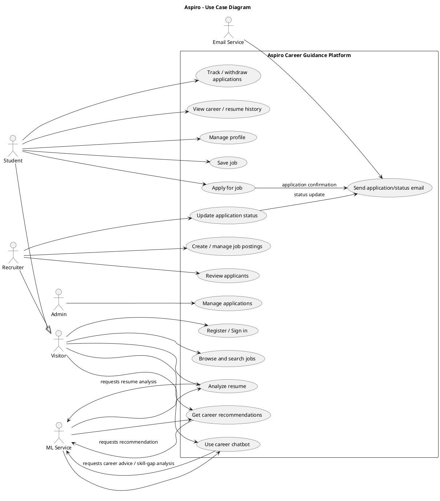
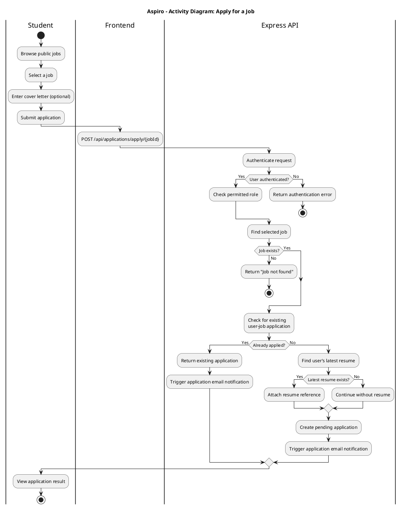
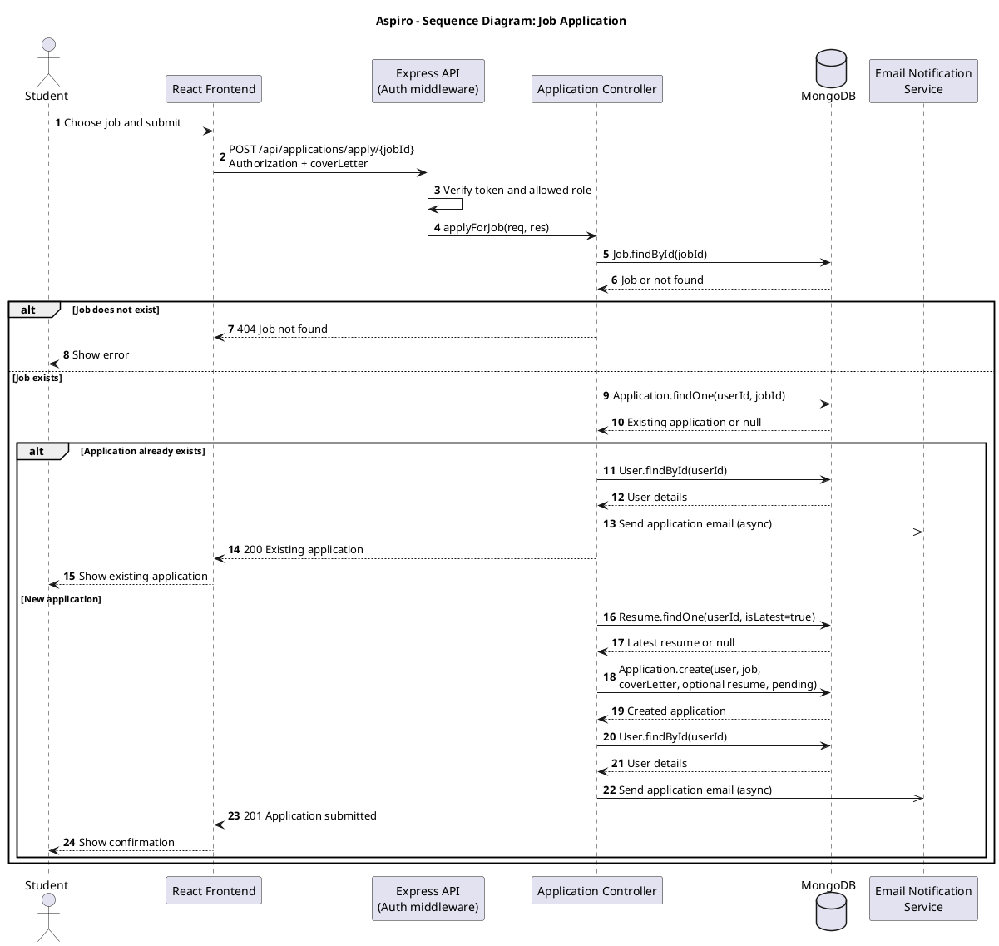
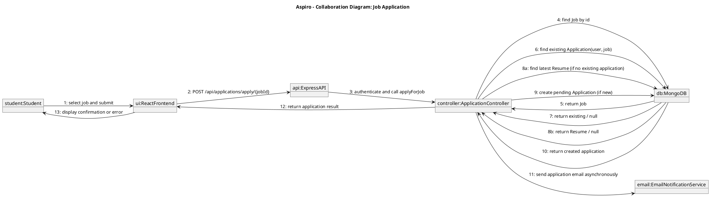
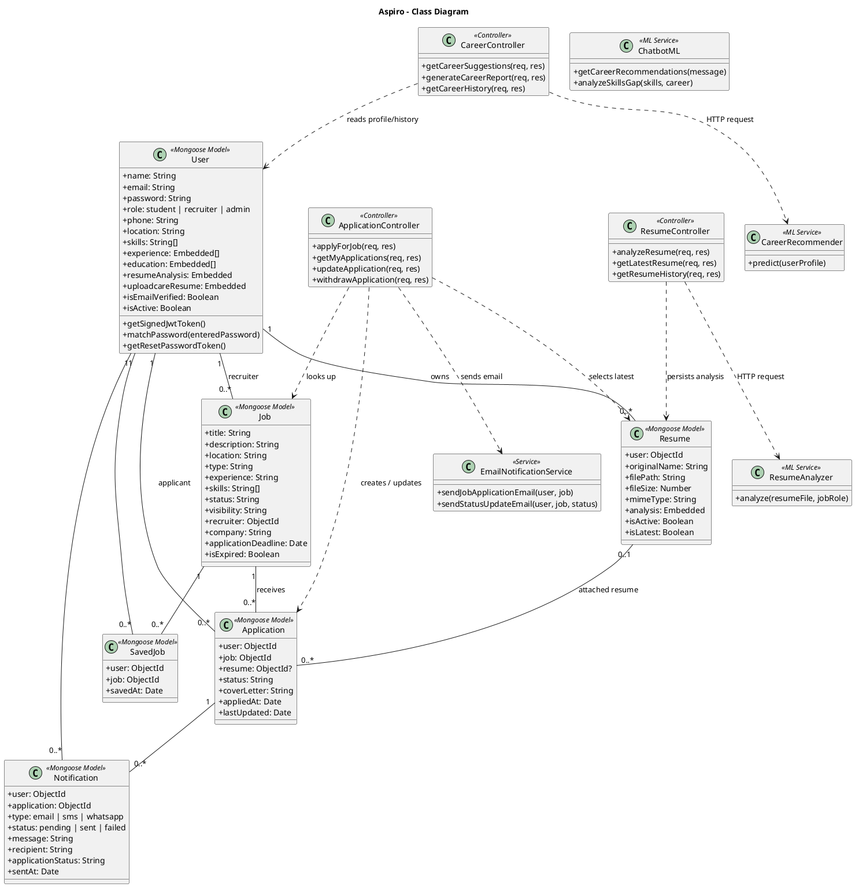

# Aspiro Project Diagrams

This document contains PlantUML source for report sections 4.3 and 4.4. Paste each source block into a PlantUML editor or save it as a `.puml` file to render it as an image.

The diagrams are based on the current application code: React frontend, Express backend, MongoDB/Mongoose models, and the Flask ML service.

## 4.3 E-R Diagram

The application stores users, job postings, applications, resumes, saved jobs, and notifications. `userId`, `jobId`, and similar fields below are MongoDB ObjectId references. `Application(userId, jobId)` and `SavedJob(userId, jobId)` have unique compound indexes.

```plantuml
@startuml
title Aspiro - Entity Relationship Diagram
hide circle
skinparam linetype ortho

entity "User" as User {
  * _id : ObjectId <<PK>>
  --
  name : String
  email : String <<unique>>
  password : String
  role : student | recruiter | admin
  phone : String
  location : String
  skills : String[]
  experience : Embedded[]
  education : Embedded[]
  resumeAnalysis : Embedded
  uploadcareResume : Embedded
  isEmailVerified : Boolean
  isActive : Boolean
  createdAt : Date
  updatedAt : Date
}

entity "Job" as Job {
  * _id : ObjectId <<PK>>
  --
  title : String
  description : String
  location : String
  type : String
  salaryMin : Number
  salaryMax : Number
  experience : String
  skills : String[]
  requirements : String
  benefits : String
  status : String
  visibility : String
  recruiter : ObjectId <<FK User>>
  company : String
  applications : ObjectId[] <<FK Application>>
  applicationDeadline : Date
  isExpired : Boolean
  createdAt : Date
  updatedAt : Date
}

entity "Application" as Application {
  * _id : ObjectId <<PK>>
  --
  user : ObjectId <<FK User>>
  job : ObjectId <<FK Job>>
  resume : ObjectId <<FK Resume, optional>>
  status : String
  coverLetter : String
  appliedAt : Date
  lastUpdated : Date
  UNIQUE(user, job)
}

entity "Resume" as Resume {
  * _id : ObjectId <<PK>>
  --
  user : ObjectId <<FK User>>
  filename : String
  originalName : String
  filePath : String
  fileSize : Number
  mimeType : String
  analysis : Embedded
  isActive : Boolean
  isLatest : Boolean
  createdAt : Date
  updatedAt : Date
}

entity "SavedJob" as SavedJob {
  * _id : ObjectId <<PK>>
  --
  user : ObjectId <<FK User>>
  job : ObjectId <<FK Job>>
  savedAt : Date
  UNIQUE(user, job)
}

entity "Notification" as Notification {
  * _id : ObjectId <<PK>>
  --
  user : ObjectId <<FK User>>
  application : ObjectId <<FK Application>>
  type : email | sms | whatsapp
  status : pending | sent | failed
  message : String
  recipient : String
  applicationStatus : String
  sentAt : Date
  error : String
}

User ||--o{ Job : recruits
User ||--o{ Application : submits
Job ||--o{ Application : receives
User ||--o{ Resume : owns
Resume o|--o{ Application : attached to
User ||--o{ SavedJob : saves
Job ||--o{ SavedJob : bookmarked as
User ||--o{ Notification : receives
Application ||--o{ Notification : status updates
@enduml
```

## 4.4 User Modeling Language Diagrams

### 4.4.1 Use Case Diagram



### 4.4.2 Activity Diagram

This activity shows the job-application workflow from the student dashboard through the backend.



### 4.4.3 Sequence Diagram

This sequence follows the implemented `POST /api/applications/apply/:jobId` route.



### 4.4.4 Collaboration Diagram

This communication (collaboration) diagram presents the same application workflow, emphasizing the numbered messages between objects.



### 4.4.5 Class Diagram

The class diagram shows the persisted domain models and the main request-processing/integration components.



## Notes for the Report

- The database is MongoDB, so the diagram labels ObjectId references as foreign-key-like references; they are not relational SQL constraints.
- `Application` and `SavedJob` prevent duplicate user/job pairs through unique compound indexes.
- Resume analysis and career recommendation requests are forwarded by the Express backend to the Flask ML service.
- Resume analysis and career suggestions can be invoked without authentication in the current route setup; results are associated with a user only when the request has an authenticated user.
- The `Notification` model is included because it exists in the backend data model. The application email flow is handled by the email notification service.
- The job-application route is described for students, although its current authorization middleware also permits recruiter accounts.
